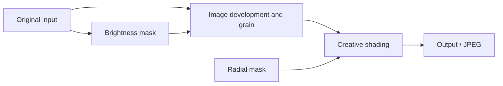

# COLOR and MONO processing jobs

PEN-F build 3101 develops COLOR and creative MONO differently. COLOR attaches
creative shading to its main development request. The ordinary MONO route creates
a brightness mask, develops the image with grain, then applies shading to the
developed result before final output.

This is a native **buffer and request dependency** map. The emulator runs CPU
builders, packers and callbacks; allocation, dimensions and queue acceptance are
explicit models. It does not execute ISP pixels or hardware completion.

## Work lists, requests and units

An outer work-list entry has a function, callback and completion token. One entry
can submit several processing requests. A request configures several ISP units;
matrix, HSL and tone controls are not necessarily separate jobs or RTOS tasks.

The checked ordinary route uses 5184×3888 input, JPEG output, a radial-mask
descriptor and `job+12204 = 0`. Both input-format families `0105` and `0205` give
the following dependencies:

| Pass | Outer entry / callback | Kind / stage | Source → destination | Additional control |
| --- | --- | --- | --- | --- |
| COLOR development | `604c4c84` / `604c9168` | 0 / `0000` | Original → JPEG | Radial mask, combiner 33 |
| MONO brightness mask | `604c81db` / `604c8414` | 0 / `0900` | Original → `03a4` mask | Tone LUT `60610742` |
| MONO image + grain | `604c82eb` / `604c8428` | 0 / `0901` | Original → `0302` image | Prior mask, combiner 31 |
| MONO shading | `604c971e` / `604c98fb` | 3 / `f005` | Developed image → `0302` image | Radial mask, combiner 33 |
| MONO output | Submitted by shading entry | 3 / `0000` | Shaded image → JPEG | No mask/combiner |

Combiner 33 is selected only for nonzero shading. The MONO image pass reads the
original source again; it does not develop the mask as the photograph.

MONO therefore uses three outer entries but four requests. Grain Off retains
this list in the tested selector and sets gain zero. Shading zero also retains
the downstream requests in the supplied-mask fixture; upstream preparation at
zero strength has not been established.

Setting `job+12204 = 1` selects stage `0902`, combiner 32 and alternative grain
gains without a separate full-size mask allocation. Its user-facing meaning is
unknown; it must not be labeled live view or High Res from this observation alone.

## Controls within main development

These are configuration correspondences, **not a proven pixel execution order**:

| Operation | Camera code / data | Evidence limit |
| --- | --- | --- |
| Raw/front-end processing | `604e874f`, `604e7505`, `604f2db4` | Individual WB, lens, demosaic and calibration steps not fully separated |
| Matrix / MONO filter | `604f45a6`, nine i16 values at +88…+104 | Concrete matrix packing; full calibration arithmetic not mapped |
| Six-axis hue/saturation | `604f55de → 604f556c`, +108…+128 | Native preset selection and packing exercised |
| RGB gamma | `604f6083` | Curve families and configuration identified |
| Global chroma gain | `604f698e → 604f6676`, +84 | Separate from twelve-sector HSL |
| Twelve-sector HSL | `604f747f`, +`2a4` | Builder, upload and physical HSL tests |
| Luminance tone | `604f7c76 → 604f75e5`, pointer +`1230` | Mask and ordinary curve selection exercised |
| Chroma suppression / tint | `604f7d50`, `604f83f1` | Tint packing established; suppression less complete |
| Sharpening | `604f3ba1` | Gain/coring/limit construction and upload |
| Companion processing | `604ec9e0` | Includes color/ART controls; cannot all be called noise reduction |
| Grain | `604fb7b8 → 604ea2ba` | Gain, mask, seed and register configuration |
| Shading | Combiner 33 | COLOR-attached or MONO-late request |
| Output / JPEG | `604ae200`, `604ad7e4` | Routing and encoder setup; no emulated JPEG hardware |

Dispatcher `604f2973` selects full input-family-1 wrapper `604f88e3`, which
configures front-end and sharpening before common builder `604f8543`. Family 2
uses `604f8911`. CPU configuration call order alone does not prove ISP order.

## Late image processing and format traps

The unchanged MONO shading request bypasses the ordinary color/tone and companion
paths at `604aa9f4` / `604aaa74`. Its input already contains the developed image.
The final matching-size JPEG request can go directly to encoder setup, rather
than run a second full development pipeline.

Explicit kind-3 controls distinguish `0302` image input from `03a4` mask input.
`604f8936 → 604f860e` handles the image route with neutral tint; mask wrapper
`604f8955 → 604f83e2` forces mono word `00808001` even for COLOR. Keeping the
picture-mode key COLOR therefore does not alone guarantee chroma preservation.

The late tone selector `604f7ae0` recognizes specific effects and otherwise uses
neutral tone. It is not a demonstrated arbitrary-LUT interface. Applying a
highlight-protection function to the grain-mask route evaluates `h(u)`, whereas
protection based on developed brightness needs `h(T(u))`.

## Buffers and completion

The ordinary fixture requests a 20,238,336-byte mask and two 40,310,784-byte image
buffers: about 96.2 MiB in total. This is a sum of those allocations, not the
camera's complete memory demand or proof that a COLOR extension has that spare
capacity.

Static cleanup follows `604c2447 → 604c2732 → 604c2ceb → 604c2c28`, then
`604be99a` at the end of the list. Asynchronous error, cancellation, cache and
completion behavior remain only partly mapped. Request kind 0 is 1,132 bytes;
kind 3 is 624 bytes. Reading the longer tail from a kind-3 request would use stale
or unrelated memory.

The [creative-job probe](../../../tools/penf_creative_jobs_probe.py) covers 34 cases,
77 submitted requests and 14 isolated configuration controls. Its raw request
dumps can be regenerated from the pinned firmware.
